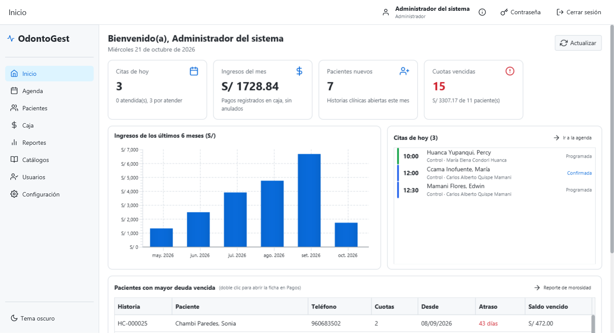

# OdontoGest

Sistema de escritorio para consultorios odontológicos con **odontograma interactivo** basado en la
NTS N.° 188-MINSA/DGIESP-2022.

Proyecto del curso de **Ingeniería de Software** — Universidad Nacional de Juliaca.
Autores: Apaza Mamani Ruben, Apaza Suca Elwin junior, Inofuente Trujillo David Alex (2026).



## Qué hace

| Módulo | Funciones principales |
|---|---|
| Pacientes | Registro con historia clínica correlativa, búsqueda paginada, anamnesis con alerta de alergias, consentimiento de datos personales (PDF). |
| Odontograma | 40 hallazgos de la NTS 188 por superficie, pieza, entre piezas y rango; odontograma inicial y de evolución; línea de tiempo y comparación; CPO-D y ceo-d en vivo; firma con cadena de integridad SHA-256; ficha odontológica en PDF. |
| Plan de tratamiento | Sugerencias automáticas desde el odontograma, fases, presupuesto y consentimiento en PDF, cronograma de cuotas. |
| Caja | Cobro con aplicación FIFO a las cuotas, recibo PDF con monto en letras, anulación con motivo, caja del día. |
| Agenda | Vista semanal por odontólogo, citas sin solapamientos, arrastrar para mover, "siguiente hueco libre", atender desde la cita. |
| Reportes | Tablero de inicio, ingresos, producción por odontólogo, morosidad, reporte epidemiológico (CPO-D/ceo-d por edad) y auditoría, con exportación a Excel. |
| Administración | Catálogos (procedimientos, hallazgos, reglas, odontólogos y horarios), usuarios y roles, configuración, consulta de DNI y correo (opcionales), respaldo y restauración. |

El manual con capturas de cada pantalla está en [docs/manual-usuario.md](docs/manual-usuario.md) y la
especificación técnica completa en [docs/PLAN.md](docs/PLAN.md).

## Usar la versión empaquetada (Windows, sin instalar Java)

1. Descomprima `OdontoGest-1.0.0-windows-x64.zip`.
2. Abra `OdontoGest\OdontoGest.exe`. La primera vez se preparan los datos de demostración (unos segundos).
3. Inicie sesión con un usuario demo:

| Usuario | Contraseña | Rol |
|---|---|---|
| `admin` | `Admin123*` | Administrador: todos los módulos |
| `odontologo` | `Odonto123*` | Odontólogo: atenciones, odontograma, planes, su producción |
| `recepcion` | `Recep123*` | Recepción: pacientes, agenda, caja |

Requisitos: Windows 10/11 de 64 bits, 400 MB libres, pantalla de 1366 × 768 o mayor.

Los datos se guardan en `%USERPROFILE%\OdontoGest\` (base de datos SQLite, adjuntos, respaldos, log y la clave de
cifrado `clave.key`); nunca en la carpeta del programa. Se puede usar otra carpeta con
`-Dodontogest.home=<ruta>`.

### Datos de demostración

En una base vacía, el seeder simula unos seis meses de trabajo con los mismos servicios que usa la interfaz:
60 pacientes (DNI ficticios que empiezan con 9, 10 menores con apoderado), 40 primeras consultas con
odontograma firmado, planes, cronogramas y pagos, 15 consultas de evolución y 120 citas entre hoy −30 y hoy +30
días. Los pacientes demo se marcan con la etiqueta **"Paciente demo"**. Se desactiva con
`app.seeder.datos-demo=false`.

## Desarrollo

Requisitos: **JDK 21** (el proyecto trae Maven Wrapper; no hace falta instalar Maven).

```bash
./mvnw javafx:run
```

```bash
./mvnw test
```

```bash
./mvnw clean package -Pempaquetar
```

- `./mvnw javafx:run` ejecuta la aplicación (también `./mvnw spring-boot:run`).
- `./mvnw test` corre las pruebas unitarias, de integración (SQLite temporal) y de arquitectura (ArchUnit), con
  JaCoCo: el paquete `dominio` debe tener al menos 70 % de cobertura (`target/site/jacoco/index.html`).
- `./mvnw clean package` genera `target/odontogest.jar` (JAR ejecutable con todas las dependencias).
- `./mvnw clean package -Pempaquetar` (en Windows) genera con `jpackage` la carpeta `target/dist/OdontoGest/`
  con `OdontoGest.exe` y su propio entorno Java, y el ZIP de entrega
  `target/dist/OdontoGest-1.0.0-windows-x64.zip`.

### Tecnologías

Java 21 · Spring Boot 3.3 (sin servidor web) · JavaFX 21 con AtlantaFX e Ikonli · SQLite con Spring Data JPA /
Hibernate · OpenPDF · Apache POI · Gson · Jakarta Mail · BCrypt · JUnit 5, AssertJ, ArchUnit y JaCoCo.

### Arquitectura

```
ui (JavaFX: FXML + controladores) → servicio (reglas de negocio, DTO record) → persistencia (repositorios y DAO)
                                         ↘ dominio (Java puro: odontograma, índices, cronogramas, agenda)
```

- Los controladores solo intercambian `record` DTO con los servicios; nunca usan entidades ni repositorios.
- `dominio` no depende de JavaFX, Spring ni JPA: ahí están los algoritmos originales y sus pruebas.
- Ningún acceso a base de datos, archivos o red corre en el hilo de JavaFX (`TareaUi`).
- Dinero en céntimos (`INTEGER`) y `BigDecimal`; fechas ISO-8601 en `TEXT`.
- Los hallazgos de un odontograma firmado son inmutables: las correcciones se hacen por anulación.

Las reglas se verifican con `ArquitecturaTest`.

```
src/main/java/com/odontogest/
  config/        carpeta de datos, reloj, restauración pendiente, hilos
  dominio/       odontograma, finanzas, agenda, tratamiento (Java puro)
  modelo/        entidades JPA          persistencia/  repositorios, DAO y conversores
  servicio/      servicios y dto/       documento/     PDF y Excel
  integracion/   DNI, correo, cifrado   seeder/        datos iniciales y demo
  ui/            controladores, componentes (odontograma, agenda) y soporte
```

## Elementos originales

Odontograma basado en eventos con capas de exclusión; detección geométrica de la superficie dental por clic;
cadena de integridad SHA-256 entre odontogramas firmados; cálculo automático de CPO-D/ceo-d con clasificación
OMS; motor de sugerencias hallazgo → procedimiento con cronograma de reparto exacto de céntimos y pagos FIFO;
búsqueda del siguiente hueco libre en la agenda. Detalle en [docs/PLAN.md](docs/PLAN.md) §0.4.

## Derechos

© 2026 Apaza Mamani Ruben, Apaza Suca Elwin junior, Inofuente Trujillo David Alex. Todos los derechos reservados.
Programa de ordenador protegido por el Decreto Legislativo N.° 822, Ley sobre el Derecho de Autor.
