# Manual de usuario — OdontoGest 1.0

Sistema de gestión de consultorio odontológico con odontograma interactivo.
Proyecto del curso de Ingeniería de Software — Universidad Nacional de Juliaca (2026).
Autores: Apaza Mamani Ruben, Apaza Suca Elwin junior, Inofuente Trujillo David Alex.

Las capturas se tomaron con los datos de demostración que trae la aplicación.

---

## 1. Primeros pasos

### 1.1 Instalación
1. Descomprima `OdontoGest-1.0.0-windows-x64.zip` en cualquier carpeta.
2. Abra `OdontoGest\OdontoGest.exe`. No hace falta instalar Java.
3. Si Windows muestra "Windows protegió su PC", elija **Más información → Ejecutar de todas formas**.

La primera vez aparece una pantalla de carga mientras se preparan los datos de demostración.

### 1.2 Inicio de sesión
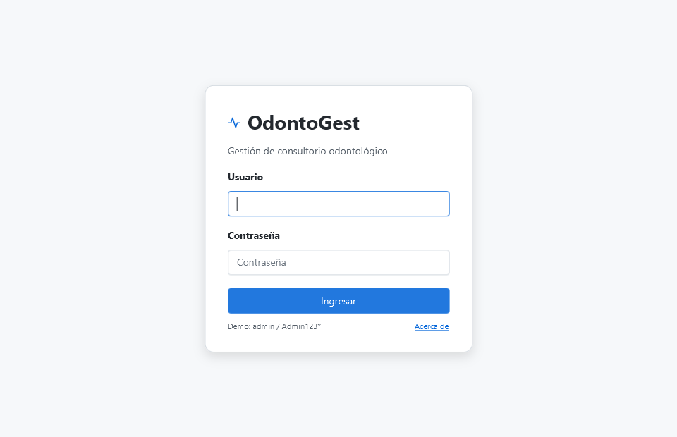

Escriba su usuario y contraseña y pulse **Ingresar**. Tras cinco intentos fallidos el usuario se bloquea unos
minutos. El enlace **Acerca de** muestra la versión y los autores.

| Usuario demo | Contraseña | Puede |
|---|---|---|
| `admin` | `Admin123*` | Todo, incluidos catálogos, usuarios, configuración, respaldos y auditoría. |
| `odontologo` | `Odonto123*` | Pacientes, anamnesis, atenciones, odontograma, planes, agenda y su producción. |
| `recepcion` | `Recep123*` | Pacientes, agenda, caja y reportes de ingresos y morosidad. |

### 1.3 Ventana principal
- **Menú lateral**: muestra solo los módulos que permite su rol.
- **Barra superior**: usuario y rol; ⓘ *Acerca de*; **Contraseña** para cambiarla; **Cerrar sesión**.
- **Tema oscuro / claro**: botón al pie del menú lateral (se recuerda al volver a abrir).
- Si no hay internet aparece el aviso "Sin internet: DNI y correo no disponibles"; todo lo demás sigue
  funcionando.

---

## 2. Inicio (tablero)

- **Citas de hoy**: cuántas hay y cuántas ya se atendieron. Clic en la tarjeta → Agenda.
- **Ingresos del mes**: pagos de caja no anulados. El odontólogo ve aquí **su producción** (procedimientos
  realizados).
- **Pacientes nuevos** del mes y **Cuotas vencidas** (monto y pacientes). Clic → reporte de morosidad.
- Gráfico de los últimos seis meses, lista de citas de hoy (doble clic abre la ficha del paciente) y los diez
  pacientes con mayor deuda vencida (doble clic abre sus pagos).
- El tablero se actualiza solo al registrar pagos o cambiar citas; también con **Actualizar**.

| Recepción | Odontólogo |
|---|---|
| 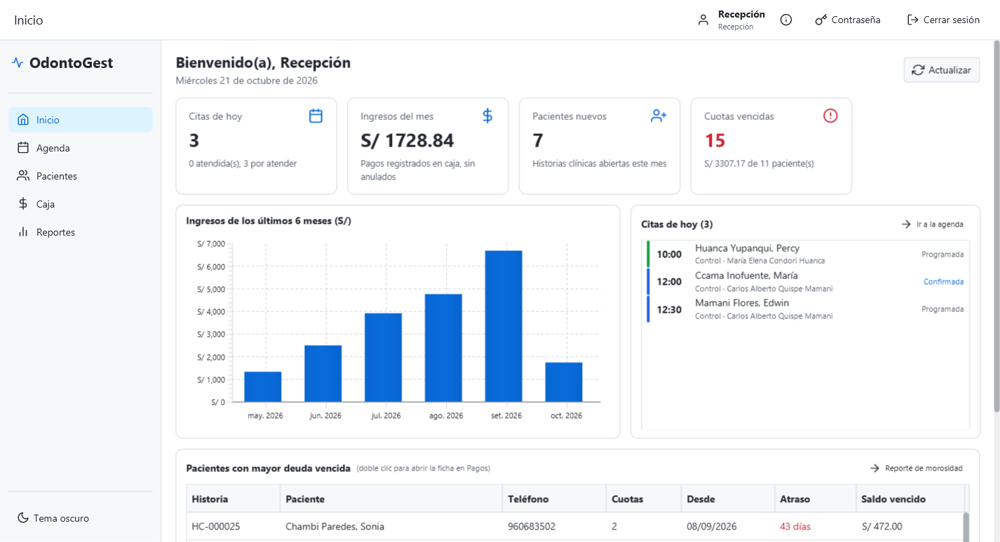 | 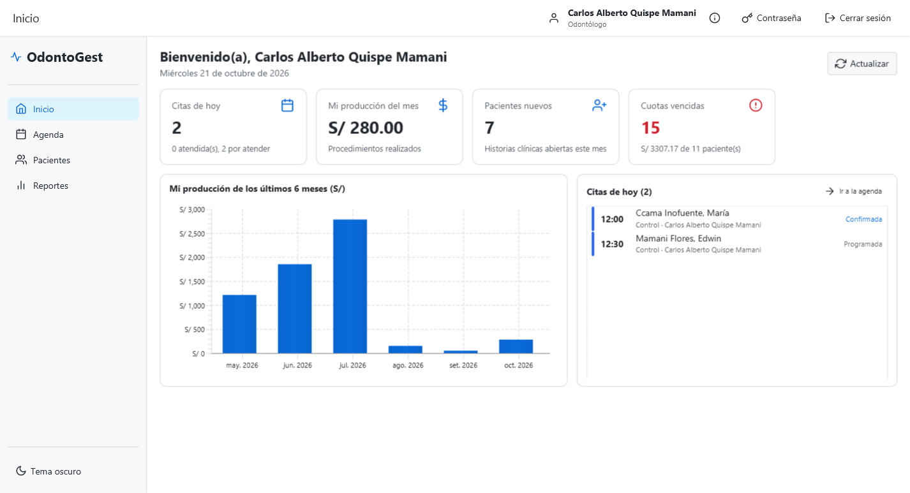 |

---

## 3. Agenda

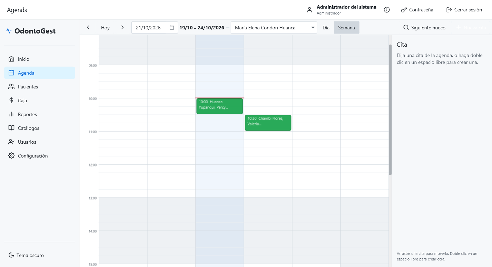

1. Elija el odontólogo y navegue con **‹ Hoy ›**, el calendario o las vistas **Día / Semana**. Las franjas grises
   están fuera del horario de atención; la línea roja es la hora actual.
2. **Nueva cita**: doble clic en un espacio libre o el botón **Nueva cita**. Paciente, duración (múltiplo de
   la grilla), motivo y, si quiere, el procedimiento del plan que se hará.
3. **Siguiente hueco** busca el primer espacio libre del odontólogo para la duración indicada.
4. Arrastre una cita para moverla. El sistema no permite citas en el pasado, fuera del horario ni cruzadas con
   otra del mismo odontólogo o del mismo paciente.
5. Al elegir una cita, el panel derecho permite **Confirmar**, **Cancelar cita**, marcar **No asistió** o **Atender
   ahora** (abre la atención del paciente con su odontograma).

---

## 4. Pacientes

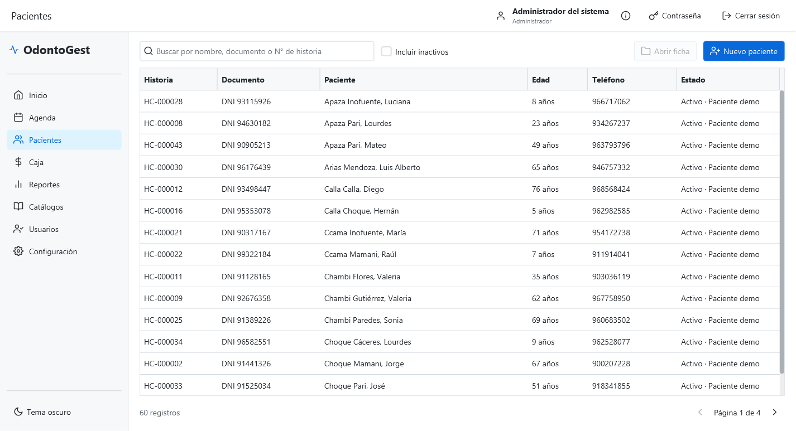

- Busque por nombre, documento o N.° de historia; marque **Incluir inactivos** para ver los desactivados.
- **Nuevo paciente**: los campos con * son obligatorios. Con DNI y la consulta de DNI configurada, los nombres se
  completan solos. Los menores de edad exigen apoderado.
- Doble clic o **Abrir ficha** para entrar a la ficha. Los pacientes de demostración llevan la etiqueta
  **Paciente demo**.

### 4.1 Ficha del paciente
La cabecera muestra historia, documento, edad, alertas (alergias, falta de consentimiento, inactivo), el **saldo
pendiente** y los botones **Nueva cita** y **Nueva atención**.

**Datos**: datos personales, contacto de emergencia y apoderado; consentimiento de datos personales (PDF para
firmar y registro de la firma); desactivar o reactivar al paciente.

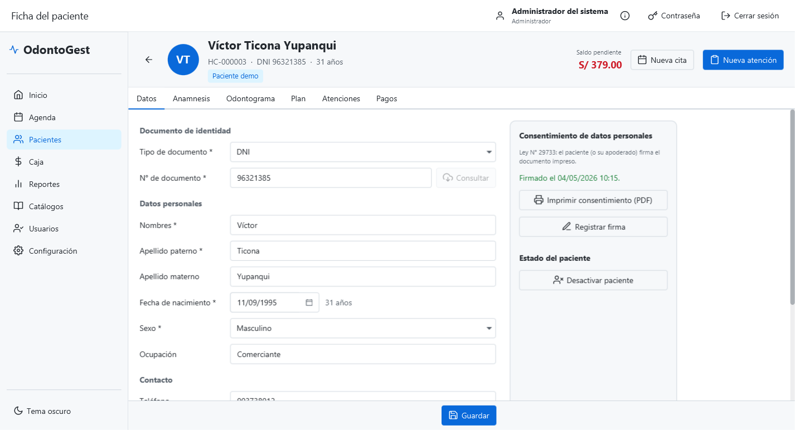

**Anamnesis**: antecedentes, alergias (generan una alerta roja en la cabecera), medicación, enfermedades,
hábitos y presión arterial.

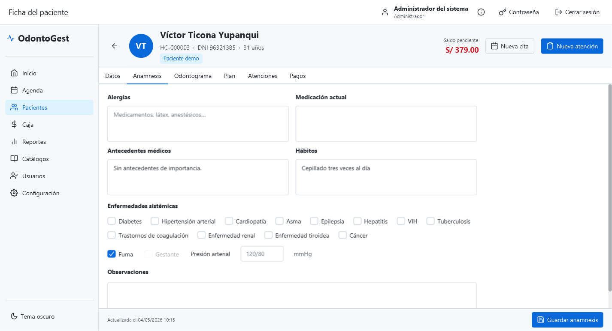

---

## 5. Odontograma

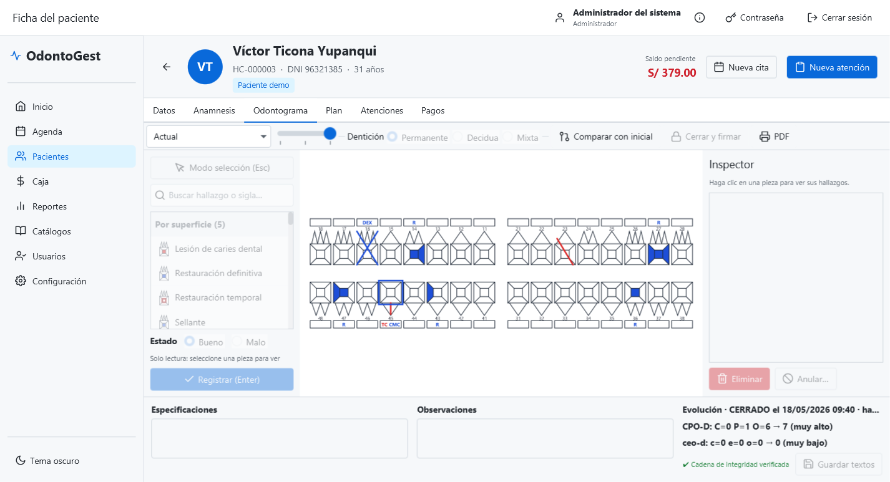

El odontograma sigue la **NTS N.° 188-MINSA/DGIESP-2022**. Se edita dentro de una atención abierta.

1. **Nueva atención** (cabecera de la ficha) abre la atención y su odontograma en borrador: el *inicial* si es
   la primera vez, de *evolución* después. La dentición (permanente, decidua o mixta) se sugiere por la edad.
2. Elija un hallazgo en la paleta (con buscador) y, si corresponde, su sigla y su estado (bueno = azul,
   malo = rojo).
3. Haga clic en la **superficie** de la pieza (oclusal, mesial, distal, vestibular, lingual/palatina) o en la
   pieza. Los hallazgos entre piezas o de rango piden la segunda pieza. **Registrar** (Enter) lo agrega.
4. El **Inspector** muestra los hallazgos de la pieza elegida. En el borrador se pueden eliminar; en un
   odontograma firmado solo se **anulan** con motivo (quedan en el historial).
5. **Cerrar y firmar**: el odontograma queda inmutable y se encadena con un hash SHA-256 al anterior
   ("Cadena de integridad verificada" al pie).

Otras funciones: la lista de la izquierda y la barra deslizante muestran el odontograma en cualquier fecha;
**Comparar con inicial** resalta los cambios; los índices **CPO-D** y **ceo-d** se calculan en vivo con su nivel OMS;
**PDF** genera la ficha odontológica.

---

## 6. Plan de tratamiento

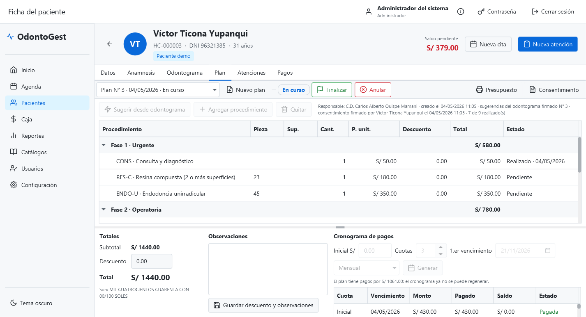

1. **Nuevo plan** crea un borrador; **Sugerir desde odontograma** agrega los procedimientos según las reglas
   (p. ej. caries de 2 superficies → resina compuesta) ordenados en fases: urgente, operatoria, rehabilitación y
   mantenimiento. También puede **Agregar procedimiento** a mano y aplicar descuentos.
2. **Proponer** fija el total; entonces se genera el **cronograma** (inicial, número de cuotas, primer
   vencimiento y frecuencia). El reparto de céntimos es exacto.
3. **Presupuesto** y **Consentimiento** generan los PDF. **Aceptar…** registra quién firma el consentimiento: desde
   ese momento las cuotas se pueden cobrar.
4. En cada atención se marcan los procedimientos realizados (pestaña Atenciones). **Finalizar** o **Anular**
   cierran el plan.

---

## 7. Atenciones

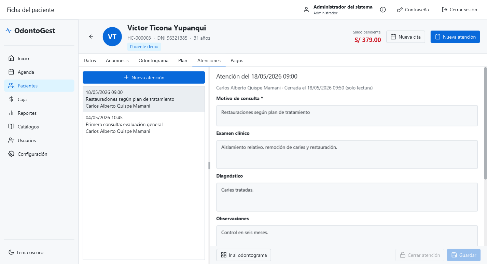

Línea de tiempo de las atenciones. En la atención abierta se registran motivo, examen clínico, diagnóstico y
observaciones, y se marcan los procedimientos del plan realizados. **Cerrar atención** exige haber firmado el
odontograma; si la atención vino de una cita, la cita pasa a *Atendida*.

---

## 8. Pagos y caja

### 8.1 Pestaña Pagos de la ficha
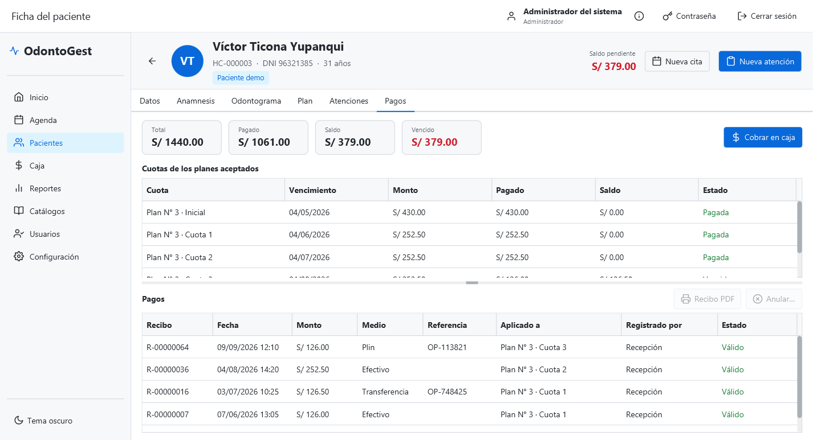

Estado de cuenta: total, pagado, saldo y vencido; cuotas con su estado (pendiente, parcial, vencida, pagada) y
pagos con el detalle de a qué cuotas se aplicaron. **Cobrar en caja** lleva a la caja con el paciente elegido.

### 8.2 Caja
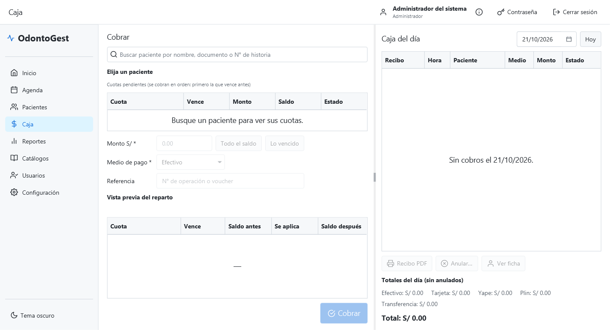

1. Busque al paciente: aparecen sus cuotas pendientes en orden de vencimiento.
2. Escriba el monto (o **Todo el saldo** / **Lo vencido**), el medio de pago y la referencia. La **vista previa**
   muestra cómo se reparte: primero la cuota que vence antes (FIFO).
3. **Cobrar** registra el pago, genera el recibo correlativo y abre el **recibo PDF** con el monto en letras.
4. A la derecha, la caja del día con totales por medio de pago. **Anular…** (solo administrador) pide motivo y
   devuelve el saldo a las cuotas.

---

## 9. Reportes

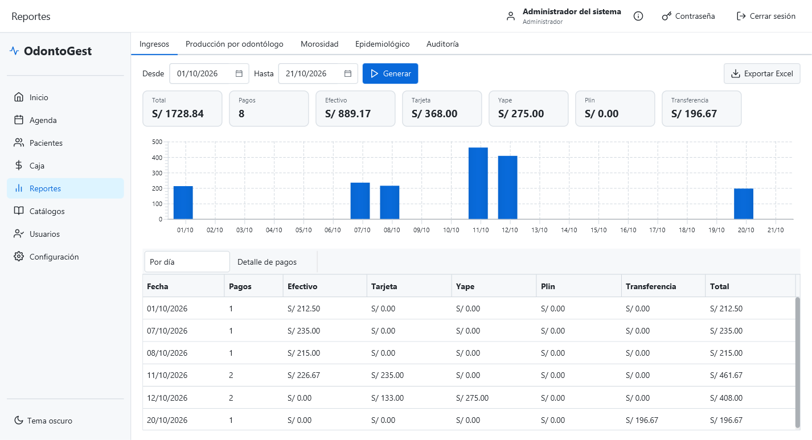

Elija el rango de fechas y pulse **Generar**; **Exportar Excel** guarda un libro con totales, fechas y montos
numéricos listo para imprimir.

| Pestaña | Contenido | Quién |
|---|---|---|
| Ingresos | Por día y medio de pago, gráfico y detalle de pagos | Administrador, recepción |
| Producción por odontólogo | Procedimientos realizados y monto | Administrador (todos), odontólogo (la suya) |
| Morosidad | Pacientes con cuotas vencidas y días de atraso | Administrador, recepción |
| Epidemiológico | CPO-D y ceo-d promedio por grupo de edad, nivel OMS | Administrador, odontólogo |
| Auditoría | Quién hizo qué y cuándo, con filtro por acción | Administrador |

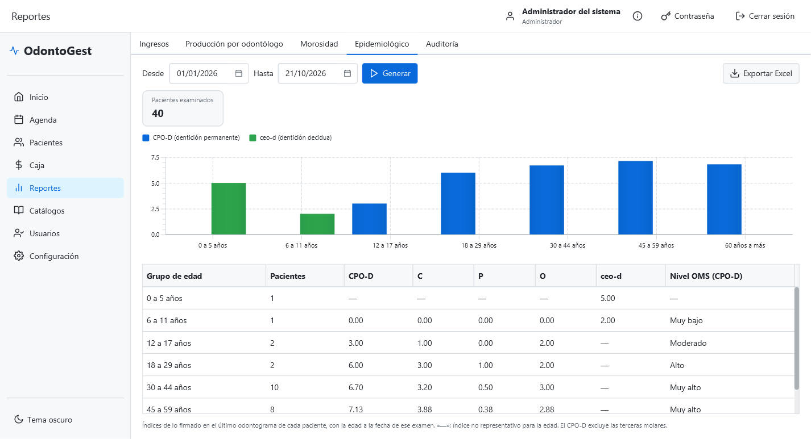

---

## 10. Administración (solo administrador)

### 10.1 Catálogos
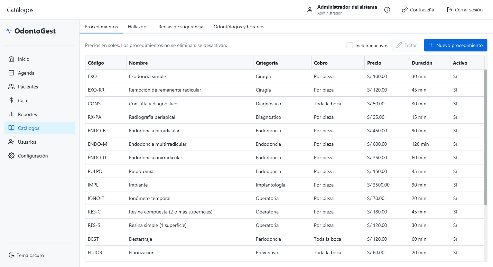

Tarifario de procedimientos (precio y forma de cobro), catálogo de hallazgos de la NTS 188, reglas de sugerencia
hallazgo → procedimiento, y odontólogos con su color de agenda y horario de atención.

### 10.2 Usuarios
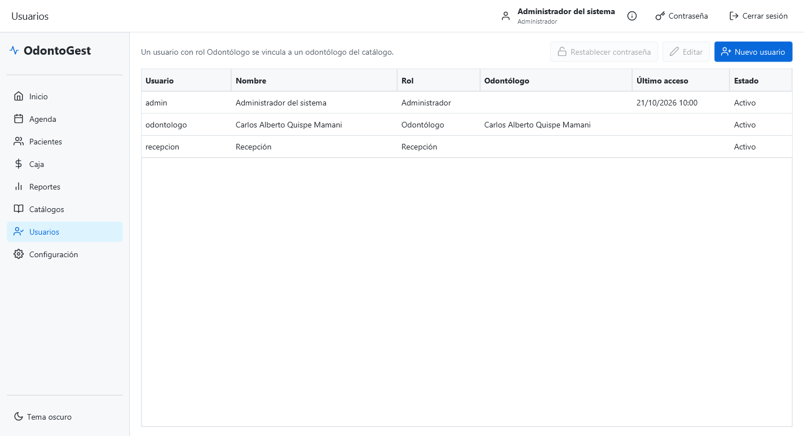

**Nuevo usuario** con su rol (un usuario odontólogo se vincula a su ficha del catálogo de odontólogos);
**Editar…** para cambiar nombre, rol o desactivarlo; **Restablecer contraseña** asigna una nueva y desbloquea al
usuario si superó los intentos fallidos.

### 10.3 Configuración
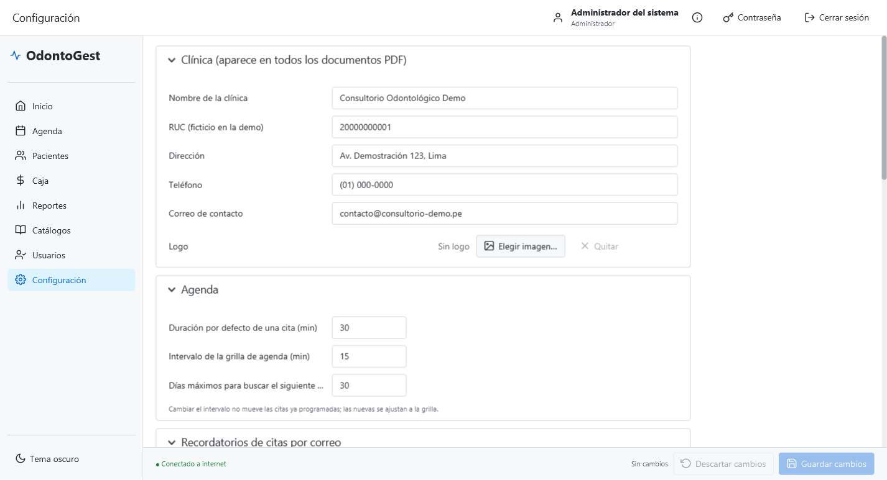

Datos y logo de la clínica (aparecen en todos los PDF), agenda (intervalo y duración por defecto), recordatorios
por correo, servidor de correo SMTP (con **Enviar correo de prueba**), API de consulta de DNI (con **Probar
conexión**) y odontograma. Las contraseñas y tokens se guardan cifrados.

### 10.4 Respaldo y restauración
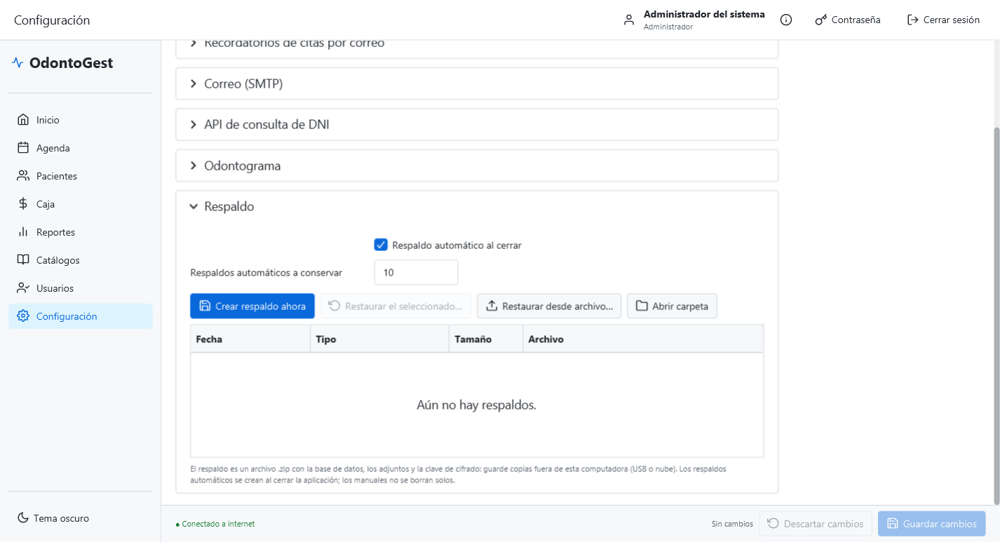

- **Crear respaldo ahora** guarda un `.zip` con la base de datos, los adjuntos y la clave de cifrado en la
  carpeta de respaldos (**Abrir carpeta**). Copie los respaldos fuera de la computadora (USB o nube).
- Al cerrar la aplicación se crea un respaldo automático; se conservan los últimos indicados en
  "Respaldos automáticos a conservar". Los manuales no se borran.
- **Restaurar el seleccionado…** o **Restaurar desde archivo…** valida el respaldo y lo aplica al volver a abrir
  OdontoGest. Los datos que había antes se guardan en `respaldos\antes-de-restaurar-…`.

---

## 11. Acerca de

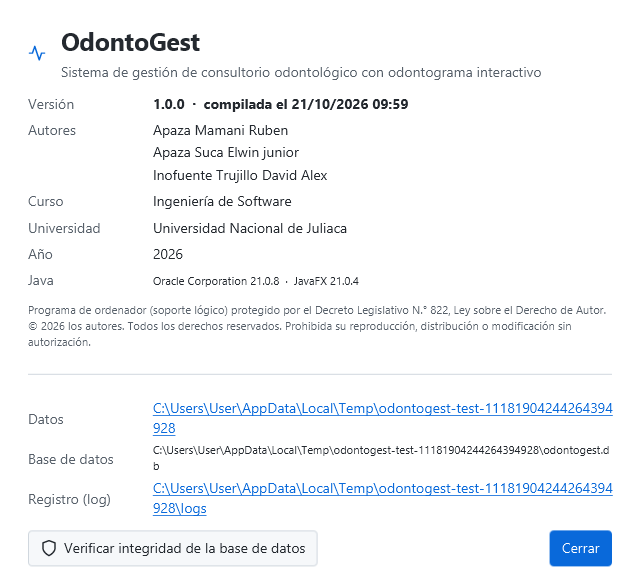

Versión, autores, curso, universidad, aviso de derechos de autor, carpetas de datos y del registro (log), y
**Verificar integridad de la base de datos**.

---

## 12. Preguntas frecuentes

- **¿Dónde están mis datos?** En `C:\Users\<usuario>\OdontoGest\`. Para llevarlos a otra PC, cree un respaldo y
  restáurelo allá.
- **No puedo cerrar la atención.** Primero cierre y firme el odontograma (pestaña Odontograma → *Cerrar y
  firmar*).
- **No puedo regenerar el cronograma.** Ya hay pagos aplicados a sus cuotas; anule los pagos si fue un error.
- **No llega el recordatorio por correo.** Revise Configuración → Correo (use *Enviar correo de prueba*) y que el
  paciente tenga correo y acepte recordatorios. Sin internet no se envían.
